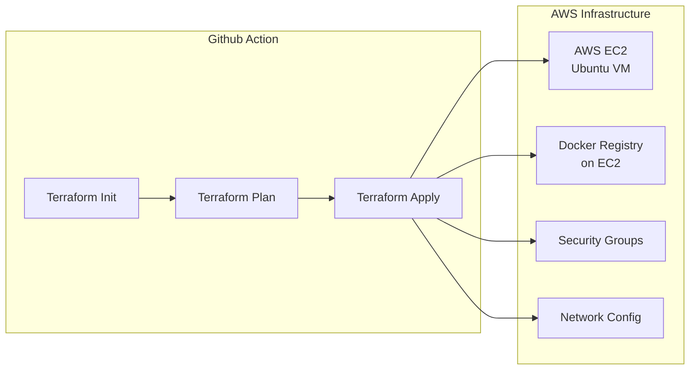
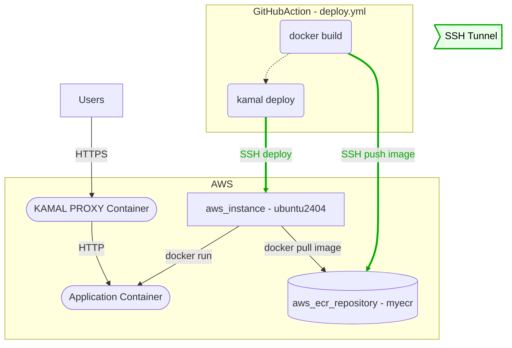

<!-- _class: big center -->

# Continious Delivery

---

# Provisionieren mit Terraform



---

# Deployment mit Kamal



---

# Deployment mit Kamal (local Registry)

````mermaid width=730px
flowchart TD

    subgraph GitHubAction - deploy.yml
      DOCKER@{ shape: rounded, label: "docker build" }
      KAMAL@{ shape: rounded, label: "kamal deploy" }
      REG[(Local Docker Registry - localhost:5000)]
    end

    subgraph AWS
      VM[aws_instance - ubuntu2404]
      PROXY([KAMAL PROXY Container])
      APP([Application Container])
    end

    DOCKER -.-> KAMAL

    DOCKER -->|push image| REG
    KAMAL -->|**SSH** deploy| VM
    VM -->|docker run| APP
    VM -->|**SSH** docker pull image| REG

    Users[Users] -->|HTTPS| PROXY
    PROXY -->|HTTP| APP

    style REG fill:#ffcc66,stroke:#cc6600,stroke-width:4px,color:#000

    %% SSH Tunnel Verbindungen grün färben
    linkStyle 2 stroke:#00aa00,stroke-width:3px,color:#00aa00
    linkStyle 4 stroke:#00aa00,stroke-width:3px,color:#00aa00

    %% Legende
    L1>"SSH Tunnel"]
    style L1 fill:#eaffea,stroke:#00aa00,stroke-width:2px,color:#000
```
